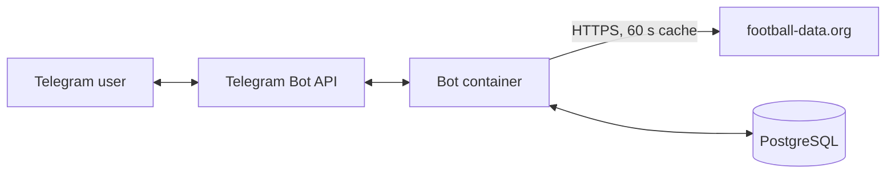

# GoalZone

[](https://github.com/Qahramon1412/goalzone/actions/workflows/ci.yml)

An Uzbek-language Telegram bot for Premier League data. It is a learning project that I use to practice Python and a DevOps/DevSecOps workflow: containers, automated checks, and security scanning.

## Features

| Command | What it does |
|---|---|
| `/start` | Welcome message, saves the user |
| `/today` | Today's Premier League matches (Tashkent time) |
| `/table` | Current league table |
| `/fixtures` | Matches for the next 7 days |
| `/favorite <team>` | Saves a favorite team (name, short name, or 3-letter code such as `ARS`) |
| `/my` | Upcoming matches of your favorite team |

If the football API is down or the rate limit is hit, the bot replies with a clear message instead of crashing.

## Architecture



The bot and the database run as two containers in Docker Compose. The database port is not published to the host, only the bot can reach it over the internal network.

## Quick start (Docker Compose)

1. Get a free token from [football-data.org](https://www.football-data.org/client/register) and create a bot with [@BotFather](https://t.me/BotFather).
2. Create your settings file and fill in the values:

```bash
cp .env.example .env
```

3. Start everything:

```bash
docker compose up -d --build
docker compose logs -f bot
```

`DB_USER`, `DB_PASSWORD` and `DB_NAME` from `.env` are also used to create the PostgreSQL container. The `users` table is created from `schema.sql` the first time the database starts.

## Development

```bash
python3 -m venv .venv
source .venv/bin/activate
pip install -r requirements-dev.txt
python -m pytest -v
ruff check . && ruff format --check .
```

Running the bot outside Docker needs a local PostgreSQL with the schema from `schema.sql` loaded.

## CI (GitHub Actions)

Every push and pull request runs three jobs:

- **test**: `ruff` lint and format check, then `pytest` (14 tests, no network or secrets needed).
- **dependency-audit**: `pip-audit` on `requirements.txt`. It also runs every Monday, because new vulnerabilities appear after a release.
- **image-scan**: builds the Docker image and scans it with Trivy (HIGH and CRITICAL, fixable issues only).

## Security notes

- Secrets live only in `.env`, which is git-ignored and excluded from the Docker image by `.dockerignore`. The `.env.example` file lists variable names only.
- The container runs as a non-root user, and `pip` is removed from the final image (Trivy reported vulnerabilities in the `pip` bundled with the base image).
- SQL queries use parameters, never string formatting.
- HTTP client logs are lowered to `WARNING`, so request URLs are not written to the logs.
- Trivy itself was compromised in a supply chain attack in March 2026. The workflow therefore pins the Trivy action to a full commit SHA and the Trivy binary to a fixed version instead of `latest`.
- GitHub's own actions (`checkout`, `setup-python`) are still pinned by tag. Pinning them by SHA is on the to-do list.

## Known limitations

- One league only (Premier League), and the free API plan returns slightly delayed scores.
- The cache is in memory and is lost when the bot restarts.
- No database migrations: `schema.sql` is applied only when the database volume is created.
- The bot is not hosted 24/7. It runs locally with Docker Compose.

## Project layout

| File | Purpose |
|---|---|
| `bot.py` | Telegram command handlers |
| `api.py` | football-data.org client with 60 s cache and error handling |
| `db.py` | PostgreSQL access (`psycopg`) |
| `teams.py` | Team lookup and match filtering |
| `formatters.py` | Message text and UTC to Tashkent time conversion |
| `config.py` | Reads settings from environment variables |
| `schema.sql` | Database schema |
| `Dockerfile`, `docker-compose.yml` | Container setup |
| `tests/` | Pytest tests |

## Roadmap

- [x] MVP with `/start`, `/today`, `/table`
- [x] Modules, tests, `/fixtures`, in-memory cache
- [x] PostgreSQL: users and favorite team
- [x] Docker, Docker Compose, CI with lint, tests and security scans
- [ ] Deployment practice on a Linux VM (systemd, logs, health check)
- [ ] Prometheus and Grafana monitoring
